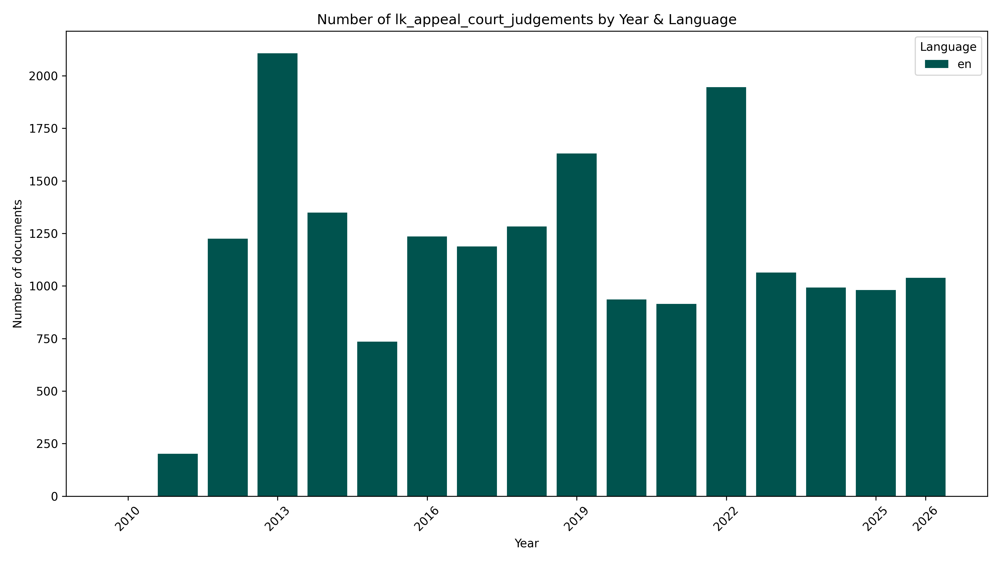

# 🇱🇰 #SriLanka `Datasets`

**1** datasets, with **18,808** documents (**14.1 GB**).

## 001 ⚖️ Appeal Court Judgements

[https://github.com/nuuuwan/lk_appeal_court_judgements/tree/data/data/lk_appeal_court_judgements](https://github.com/nuuuwan/lk_appeal_court_judgements/tree/data/data/lk_appeal_court_judgements)

A Court of Appeal judgment is a higher court ruling that reviews decisions of lower courts, shaping legal precedent and protecting citizens’ rights.

- [**18,808** documents](https://github.com/nuuuwan/lk_appeal_court_judgements/tree/data/data/lk_appeal_court_judgements) (**14.1 GB**), from **2010-10-16** to **2026-10-30**, scraped from [https://courtofappeal.lk](https://courtofappeal.lk)

- In **JSON**, **PDF** (77%), **TXT** (77%) & **🤗 Hugging Face** (77%)

- In **English**

- 🎓 Cite as **[arXiv:2510.04124](https://arxiv.org/abs/2510.04124) [cs.CL]**

---

