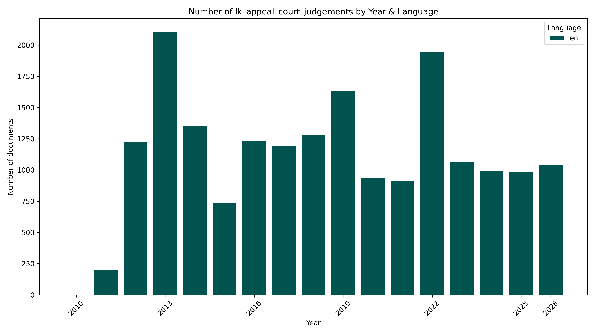

# ⚖️#SriLanka 🇱🇰 Appeal Court Judgements `Dataset`


[https://github.com/nuuuwan/lk_appeal_court_judgements/tree/data/data/lk_appeal_court_judgements](https://github.com/nuuuwan/lk_appeal_court_judgements/tree/data/data/lk_appeal_court_judgements)

A Court of Appeal judgment is a higher court ruling that reviews decisions of lower courts, shaping legal precedent and protecting citizens’ rights.

- [**18,818** documents](https://github.com/nuuuwan/lk_appeal_court_judgements/tree/data/data/lk_appeal_court_judgements) (**14.1 GB**), from **2010-10-16** to **2026-11-03**, scraped from [https://courtofappeal.lk](https://courtofappeal.lk)

- In **JSON**, **PDF** (77%), **TXT** (77%) & **🤗 Hugging Face** (77%)

- In **English**

- 🎓 Cite as **[arXiv:2510.04124](https://arxiv.org/abs/2510.04124) [cs.CL]**

## 📝 Example Metadata

```json
{
    "doc_type": "lk_appeal_court_judgements",
    "doc_id": "2026-11-03-CA-WRT-689-2024",
    "num": "CA/WRT/689/2024",
    "date_str": "2026-11-03",
    "description": "Electro Plastics (Private) Limited, Vs. Mrs Sasidevi Jaladeepan Electro Plastics (Private) Limited, Vs. Mrs Sasidevi Jaladeepan View More before Hon. Adithya Patabendige, J.",
    "url_metadata": "https://courtofappeal.lk/judgements/?case_year=2026&month=&judgment_by=",
    "lang": "en",
    "url_pdf": "https://courtofappeal.lk/wp-content/uploads/judgements/CA-WRT-0689-2024.pdf",
    "parties": "Electro Plastics (Private) Limited, Vs. Mrs Sasidevi Jaladeepan Electro Plastics (Private) Limited, Vs. Mrs Sasidevi Jaladeepan View More",
    "judgement_by": "Hon. Adithya Patabendige, J.",
    "keywords": "Writs of Certiorari, Specific Statutory Remedy, Prior Judicial Determinations, Laches, Expiry of the Impugned Caveats.",
    "legistation": "Article 140 of the Constitution of the Democratic Socialist Republic of Sri Lanka, Sections 32 and 33 of the Registration of Documents Ordinance, as amended by Act No. 32 of 2022."
}
```



## 🤗 Hugging Face Datasets


- [nuuuwan/lk-appeal-court-judgements-docs](https://huggingface.co/datasets/nuuuwan/lk-appeal-court-judgements-docs)
- [nuuuwan/lk-appeal-court-judgements-chunks](https://huggingface.co/datasets/nuuuwan/lk-appeal-court-judgements-chunks)

## 🆕 20 Latest documents

- 2026-11-03 | `CA/WRT/689/2024` | Electro Plastics (Private) Limited, Vs. Mrs Sasidevi Jaladeepan Electro Plastics (Private) Limited, Vs. Mrs Sasidevi Jaladeepan View More before Hon. Adithya Patabendige, J. | [data](https://github.com/nuuuwan/lk_appeal_court_judgements/tree/data/data/lk_appeal_court_judgements/2020s/2026/2026-11-03-CA-WRT-689-2024)
- 2026-10-30 | `CA/Writ/366/2020` | Happitiya Kariyakaranage Kamalawathie Vs. R. H. S. Priyadarshana & Others Happitiya Kariyakaranage Kamalawathie Vs. R. H. S. Priyadarshana & Others View More before Hon. Dr. Sumudu Premachandra J. | [data](https://github.com/nuuuwan/lk_appeal_court_judgements/tree/data/data/lk_appeal_court_judgements/2020s/2026/2026-10-30-CA-Writ-366-2020)
- 2026-10-30 | `CA/WRT/24/2025` | Nambukara Appukapuge Hudson Kumara Vs. Consumer Affairs Authority Nambukara Appukapuge Hudson Kumara Vs. Consumer Affairs Authority View More before Hon. Adithya Patabendige, J. | [data](https://github.com/nuuuwan/lk_appeal_court_judgements/tree/data/data/lk_appeal_court_judgements/2020s/2026/2026-10-30-CA-WRT-24-2025)
- 2026-10-30 | `CA/WRT/22/2025` | Wanigasuriya Arachchige Charunda Prasad Vs. Consumer Affairs Authority Wanigasuriya Arachchige Charunda Prasad Vs. Consumer Affairs Authority View More before Hon. Adithya Patabendige, J. | [data](https://github.com/nuuuwan/lk_appeal_court_judgements/tree/data/data/lk_appeal_court_judgements/2020s/2026/2026-10-30-CA-WRT-22-2025)
- 2026-10-30 | `CA/HCC/72/2023` | Govinthan Kanapathy Ganeshan Vs. The Hon. Attorney General Govinthan Kanapathy Ganeshan Vs. The Hon. Attorney General View More before Hon. Amal Ranaraja, J. | [data](https://github.com/nuuuwan/lk_appeal_court_judgements/tree/data/data/lk_appeal_court_judgements/2020s/2026/2026-10-30-CA-HCC-72-2023)
- 2026-10-30 | `CA/HCC/0172-0173/2024` | 1. Kamburugama Loku Acharige Chaminda Kumara 2. Sube Appu Kankanamlage Anura Dharmapriya Weerawardena Vs. The Hon. Attorney General 1. Kamburugama Loku Acharige Chaminda Kumara 2. Sube Appu Kankanamlage Anura Dharmapriya Weerawardena Vs. The Hon. Attorney General View More before Hon. Amal Ranaraja, J. | [data](https://github.com/nuuuwan/lk_appeal_court_judgements/tree/data/data/lk_appeal_court_judgements/2020s/2026/2026-10-30-CA-HCC-0172-0173-2024)
- 2026-10-29 | `CA/TAX/7/2016` | THE COMMISSIONER GENERAL OF INLAND REVENUE Vs. MACKINNONS TRAVELS (PRIVATE) LIMITED THE COMMISSIONER GENERAL OF INLAND REVENUE Vs. MACKINNONS TRAVELS (PRIVATE) LIMITED View More before Hon.Annalingam Premashanker, J. | [data](https://github.com/nuuuwan/lk_appeal_court_judgements/tree/data/data/lk_appeal_court_judgements/2020s/2026/2026-10-29-CA-TAX-7-2016)
- 2026-10-29 | `CA/TAX/47/2022` | RESUS ENERGY PLC Vs.THE COMMISSIONER GENERAL OF INLAND REVENUE RESUS ENERGY PLC Vs.THE COMMISSIONER GENERAL OF INLAND REVENUE View More before Hon.Annalingam Premashanker, J. | [data](https://github.com/nuuuwan/lk_appeal_court_judgements/tree/data/data/lk_appeal_court_judgements/2020s/2026/2026-10-29-CA-TAX-47-2022)
- 2026-10-29 | `CA/TAX/42/2022` | RESUS ENERGY PLC Vs. THE COMMISSIONER GENERAL OF INLAND REVENUE RESUS ENERGY PLC Vs. THE COMMISSIONER GENERAL OF INLAND REVENUE View More before Hon.Annalingam Premashanker, J. | [data](https://github.com/nuuuwan/lk_appeal_court_judgements/tree/data/data/lk_appeal_court_judgements/2020s/2026/2026-10-29-CA-TAX-42-2022)
- 2026-10-29 | `CA/TAX/3/2022` | RESUS ENERGY PLC Vs. THE COMMISSIONER GENERAL OF INLAND REVENUE RESUS ENERGY PLC Vs. THE COMMISSIONER GENERAL OF INLAND REVENUE View More before Hon.Annalingam Premashanker, J. | [data](https://github.com/nuuuwan/lk_appeal_court_judgements/tree/data/data/lk_appeal_court_judgements/2020s/2026/2026-10-29-CA-TAX-3-2022)
- 2026-10-29 | `CA/TAX/23/2022` | Access Engineering PLC Vs. The Commissioner General of Inland Revenue Access Engineering PLC Vs. The Commissioner General of Inland Revenue View More before Hon. M.C.B.S. Morais J. | [data](https://github.com/nuuuwan/lk_appeal_court_judgements/tree/data/data/lk_appeal_court_judgements/2020s/2026/2026-10-29-CA-TAX-23-2022)
- 2026-10-29 | `CA/TAX/211/2024` | Ceylinco Holdings PLC Vs. The Commissioner General of Inland Revenue Ceylinco Holdings PLC Vs. The Commissioner General of Inland Revenue View More before Hon.M.C.B.S. Morais J. | [data](https://github.com/nuuuwan/lk_appeal_court_judgements/tree/data/data/lk_appeal_court_judgements/2020s/2026/2026-10-29-CA-TAX-211-2024)
- 2026-10-29 | `CA/TAX/20/2021` | RESUS ENERGY PLC Vs. THE COMMISSIONER GENERAL OF INLAND REVENUE RESUS ENERGY PLC Vs. THE COMMISSIONER GENERAL OF INLAND REVENUE View More before Hon.Annalingam Premashanker, J. | [data](https://github.com/nuuuwan/lk_appeal_court_judgements/tree/data/data/lk_appeal_court_judgements/2020s/2026/2026-10-29-CA-TAX-20-2021)
- 2026-10-29 | `CA/TAX/10/2020, CA/TAX/11/2020` | S.G. Logistics (Private) Limited Vs. Commissioner General of Inland Revenue S.G. Logistics (Private) Limited Vs. Commissioner General of Inland Revenue View More before Hon. M.C.B.S. Morais J. | [data](https://github.com/nuuuwan/lk_appeal_court_judgements/tree/data/data/lk_appeal_court_judgements/2020s/2026/2026-10-29-CA-TAX-10-2020--CA-TAX-11-2020)
- 2026-10-29 | `CA/HCC/164/2025` | Galgoda Manannalage Gunapala alias Galgodayalaya Gunadasa Vs. The Hon. Attorney General Galgoda Manannalage Gunapala alias Galgodayalaya Gunadasa Vs. The Hon. Attorney General View More before Hon. Amal Ranaraja, J. | [data](https://github.com/nuuuwan/lk_appeal_court_judgements/tree/data/data/lk_appeal_court_judgements/2020s/2026/2026-10-29-CA-HCC-164-2025)
- 2026-10-28 | `CA/WRT/509/2023` | Centre for Environmental Justice (Guarantee) Limited & Others Vs. Central Environmental Authority & Others Centre for Environmental Justice (Guarantee) Limited & Others Vs. Central Environmental Authority & Others View More before Hon. B. Sasi Mahendran J, | [data](https://github.com/nuuuwan/lk_appeal_court_judgements/tree/data/data/lk_appeal_court_judgements/2020s/2026/2026-10-28-CA-WRT-509-2023)
- 2026-10-26 | `CA/Writ/119/2023` | Maskeliya Plantations PLC Vs. Minister of Tourism and Land, and Others Maskeliya Plantations PLC Vs. Minister of Tourism and Land, and Others View More before Hon. Dr. D. F. H. Gunawardhana, J. | [data](https://github.com/nuuuwan/lk_appeal_court_judgements/tree/data/data/lk_appeal_court_judgements/2020s/2026/2026-10-26-CA-Writ-119-2023)
- 2026-10-26 | `CA/PHC/17/2023` | Mukaiya Murugaiya Vs.Conservator General of Forest and Another Mukaiya Murugaiya Vs.Conservator General of Forest and Another View More before Hon. Damith Thotawatte, J. | [data](https://github.com/nuuuwan/lk_appeal_court_judgements/tree/data/data/lk_appeal_court_judgements/2020s/2026/2026-10-26-CA-PHC-17-2023)
- 2026-10-26 | `CA/BOR/2/2025` | Kekulawalage Don Dayakeerthi Piyasundara Vs. Buddhi Tharanga Karunasena. Kekulawalage Don Dayakeerthi Piyasundara Vs. Buddhi Tharanga Karunasena. View More before Hon. Damith Thotawatte, J. | [data](https://github.com/nuuuwan/lk_appeal_court_judgements/tree/data/data/lk_appeal_court_judgements/2020s/2026/2026-10-26-CA-BOR-2-2025)
- 2026-10-23 | `CA/WRT/326/2025` | Halpita Acharige Anura Chandralal Vs. Director of Pensions, Department of Pension Halpita Acharige Anura Chandralal Vs. Director of Pensions, Department of Pension View More before Hon. Adithya Patabendige, J. | [data](https://github.com/nuuuwan/lk_appeal_court_judgements/tree/data/data/lk_appeal_court_judgements/2020s/2026/2026-10-23-CA-WRT-326-2025)

---

### [More Datasets about 🇱🇰 #SriLanka](https://github.com/nuuuwan/lk_datasets)


[](https://opensource.org/licenses/MIT)
